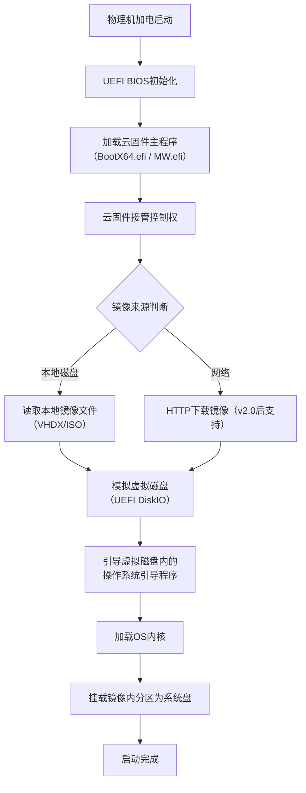

# “云固件”这三个字到底是什么含义？

> 不了解云固件（Multiware）的读者，第一次看到这三个字的时候，一定会联想“云固件”是不是云主机上用的固件程序。本文用最精简的语言来说一下“云固件”到底是什么。

“云固件”并非指云端服务器固件，而是一个**基于UEFI的本地引导程序**，核心功能是让物理机直接启动本地的虚拟磁盘镜像文件（如VHD/VHDX）。

下图详细拆解了“云固件”从加电到进入系统的完整启动链路：

## 云固件（Multiware）启动原理详解

---

## 核心环节解析

### 1. 与传统启动的本质区别
*   **传统启动**：BIOS/UEFI → 硬盘MBR/GPT → 系统引导 → OS。
*   **云固件启动**：UEFI → **云固件程序** → **解析镜像文件** → 模拟磁盘 → 系统引导 → OS。
*   **关键**：云固件插在固件和操作系统之间，充当了“**镜像文件加载器**”的角色。

### 2. “云”的含义
此处的“云”并非指公有云，而是指：
*   **部署像云一样灵活**：系统以文件（镜像）形式存在，可通过网络下载、U盘拷贝，实现“复制即安装”。
*   **资源像云一样集中**：镜像可集中存储在云端镜像服务器，通过HTTP协议在启动前下载，实现任意系统选择和启动。

### 3. 两阶段启动流程
| 阶段 | 执行者 | 关键动作 |
| :---: | :---: | :--- |
| **第一阶段** | **云固件主程序** | 1. 读取配置文件（vd.config） 2. 定位镜像文件（VHDX） 3. 将文件模拟成虚拟磁盘设备 |
| **第二阶段** | **镜像内OS引导** | 1. 加载内核与驱动 2. 将虚拟磁盘识别为系统盘（C盘/根分区） 3. 云固件退出，控制权移交OS |

### 4. 技术依赖
*   **硬件**：必须支持UEFI启动（2015年后主流x86电脑）。
*   **镜像**：通常为VHDX格式，支持动态扩展，内含完整的系统分区。

---

## 为什么需要云固件？
*   **极速系统部署**：无需安装，复制镜像文件即可拥有完整系统。
*   **多系统隔离**：Windows、Linux、国产OS镜像可以共存，互不干扰，无须单独分区。
*   **极简备份还原**：复制文件即备份，系统崩溃只需删除坏镜像，复制备份镜像即可恢复。
*   **镜像差分**： 手动或者自动差分，父镜像只读，子镜像可读可写，重启即可复原。

如果需要制作启动盘或配置镜像，可参考公众号内的《云固件启动U盘制作教程》。