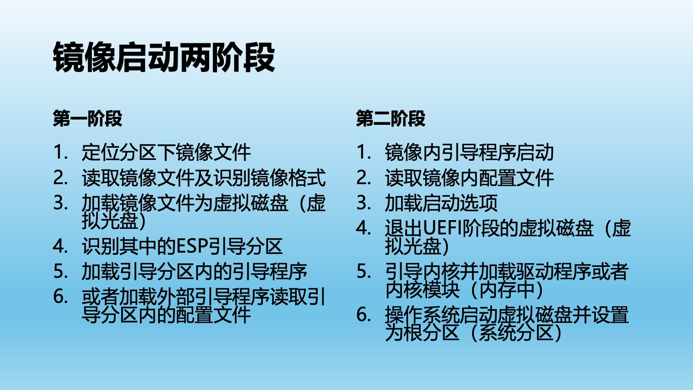
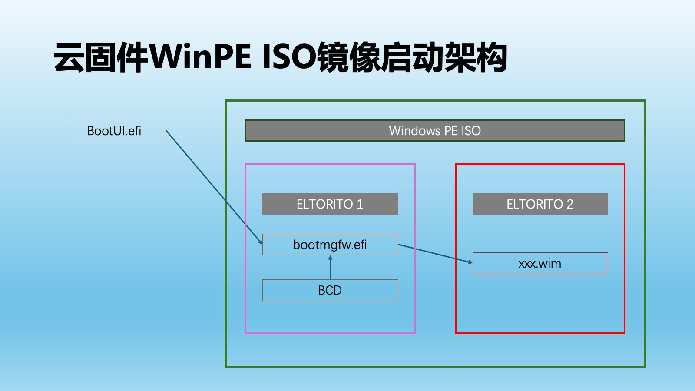

# 301.启动原理

在初级教程102篇中间，云固件系统被分解成“云固件主程序”和“云固件镜像”两个部分。云固件主程序负责引导云固件镜像文件。那云固件主程序是如何引导云固件镜像的呢？

## 1.引导过程

计算机加电后，CPU、内存、外设等等都会被逐一启动，最后到BIOS芯片，CPU就会执行BIOS内存储的固件程序。在UEFI规范中，定义了最终引导的存储设备，BIOS内的BDS程序就会按照配置扫描可用的引导程序，如存在，固件就会把计算机控制权转移给这个引导程序。

在x86_64架构下，默认的引导程序为ESP分区下的/EFI/BOOT/Bootx64.efi文件，FAT文件系统下不区分大小写，BOOTX64.EFI也是正确的。

如果用户的BIOS里面设置了其他引导项，比如108教程里面设置了云固件的引导项/EFI/MW/MW.efi，根据引导顺序，BIOS也会优先引导。

由于大多数计算机用户都使用Windows，因此，很多个人计算机主板的BIOS都会将Windows的引导程序/EFI/Microsoft/Boot/bootmgfw.efi作为默认引导程序。这个情况也导致了不少使用独占模式的云固件用户，在Windows更新后发现引导错误。究其原因，就是被Windows引导程序抢占第一引导顺序，然后引导配置文件BCD不存在，导致无法启动。

## 2.镜像引导

相对于传统模式安装的操作系统，BIOS能够读取全部存储设备，找到ESP分区，并启动操作系统的引导程序。但是，将系统安装到镜像文件后，BIOS是无法找到镜像文件里面的操作系统引导程序的。

云固件主程序这时候就在两者之间建立了一个桥梁，BIOS引导云固件，云固件再引导镜像内的操作系统。

镜像引导就可以分成下图的两个阶段。

在第一阶段，其实就是云固件引导。

云固件引导程序根据配置文件找到镜像文件，读取镜像文件内容并识别镜像格式，将镜像文件模拟为虚拟磁盘或者虚拟光盘。

加载虚拟磁盘（虚拟光盘）后，系统内就出现了一块新的磁盘，引导程序识别出来新的磁盘，通过遍历的方法找到ESP分区，按照配置读取默认引导程序或者指定的引导程序，如果引导程序存在，那么加载引导程序到内存，启动并转移系统控制权。

在第二阶段，就是操作系统引导。

操作系统引导程序，根据自身操作系统的不同，读取配置文件，如果有启动选项，那么也需要应用启动选项。引导程序，根据配置，加载内核、驱动程序（内核模块）到内存后，退出UEFI模式，将计算机控制权转移给内核。

操作系统内核启动后，加载镜像文件中的分区为系统分区C盘或者根分区，结束启动过程。

经过上述两个阶段，镜像引导就成功结束了。

## 3.启动难点

前面的过程描述了镜像启动的标准过程。在这两个阶段中，均存在了不少难点。

在第一阶段，镜像文件存储在文件系统中，不同的操作系统要求不同的文件系统，因此云固件需要支持常见的文件系统，包括NTFS、ext4、exfat。

镜像文件作为文件，有文件名和目录名，不同的文件名和目录名在不同的操作系统中呈现方式也不同，比如"\\"和"/"。这些都会导致无法识别。

镜像文件的格式，实现方式也不同，比如Windows支持VHD和VHDx格式，这些镜像文件内部格式完全不同，存储的数据大小端也不同，这些识别过程需要大量代码来处理。同时，镜像文件格式还支持固定大小、动态大小、差分等等子格式，也增加了难度。

在第二阶段，绝大多数操作系统并不支持自动从镜像文件内启动。因此，每种不同系统都需要有合适的方式来让操作系统支持从镜像文件内启动。

比如Windows系统，从Windows 7开始支持VHD本地启动模式，因此，调整Windows的启动配置文件BCD就可以借助Windows的VHD本地启动功能实现镜像启动。但是，直接调整镜像内BCD配置，然后用镜像内ESP分区下Windows boot manager来启动，就会发现Windows会出现蓝屏（BSOD）无法启动。所以，让操作系统支持从镜像文件内启动并不简单。

## 4.Windows PE 启动架构

镜像文件启动最简单的例子是Windows PE的ISO文件。

在第一阶段，云固件加载ISO文件，模拟为虚拟光盘，并找到ELTORITO 1分区内的bootmgfw.efi。

在第二阶段，Windows引导程序bootmgfw.efi读取配置文件BCD后，直接将WIM文件释放到内存中，之后再也不需要读取ISO文件，因此没有后续的复杂处理。

Windows引导程序转移引导给winload.efi，最后加载内存中的Windows内核文件ntoskrnl.exe，然后退出UEFI模式，操作系统继续启动，最终进入Windows PE桌面。

## 5.总结

云固件主程序，在云固件的体系下，作为一个引导程序，实现了镜像文件的物理机引导。这个方式本质上弥补了之前镜像文件使用的最大缺失。不同的操作系统、不同的镜像格式，第二阶段的启动方法变化多端，也是实现上的最大难点。镜像启动标准方式并不能解决各种不同系统的镜像启动。

针对不同的系统，云固件主程序在标准过程的基础上，拓展了辅助启动镜像，这个架构将在下一章讲解。

